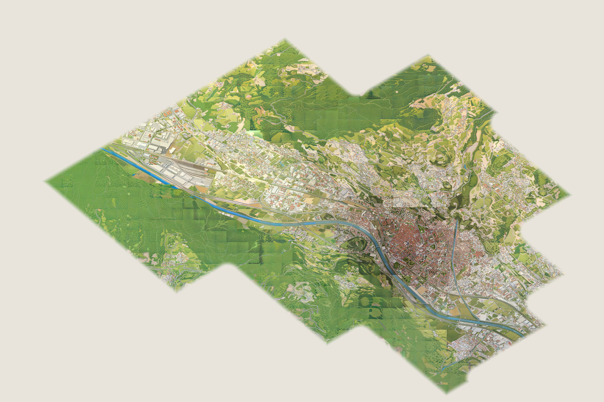

# Mondo Isometrico Trento

Mappa isometrica dipinta di **Trento**, costruita da open data: la città, la valle da Spini di Gardolo a Ravina e le colline intorno (Povo, Martignano, Cortesano, Villamontagna, Calisio, Vela, Sardagna, Ravina monte).



Progetto locale, non pubblicato online. Fork di [Mondo Isometrico](https://github.com/dg996/mondoisometrico) di Domenico Gagliardi (Roma), a sua volta basato su [Isometric World](https://github.com/krasun/isometricworld) di Dmytro Krasun.

## Cosa c'è

- Regione `trento`: origine Piazza Duomo (46.0679, 11.1211), heading 40°, quota base 242 m
- Città `/trento`
- Area pilota `trento-duomo` più 16 aree dipinte: `trento-citta`, `trento-nord`, `trento-sud`, `trento-est`, `trento-spini`, `trento-povo`, `trento-martignano`, `trento-gardolo`, `trento-ovest`, `trento-cortesano`, `trento-villamontagna`, `trento-calisio`, `trento-vela-sud`, `trento-vela-nord`, `trento-sardagna`, `trento-ravina-monte` (definite in `pipeline/src/areas.ts`)
- Mappa esportata in `data/web/regions/trento`: 761 tile, pronta per il server di sviluppo
- Altezze degli edifici dal LiDAR della Provincia autonoma di Trento (`pipeline/src/pat-lidar.ts`), terreno da Copernicus DEM, suolo ed edifici da OpenStreetMap
- Diario di lavoro completo, con misure e controlli di ogni giro: [TRENTO-PILOT.md](TRENTO-PILOT.md)

## Vederla in locale

Serve Node 24+.

```sh
npm install
cp .env.example .env
cd web && ../node_modules/.bin/astro dev --port 4391 --host 127.0.0.1
```

Poi apri `http://127.0.0.1:4391/trento`. Il tasto P mostra il render 3D sotto la pittura. In sviluppo le tile arrivano da `data/web/regions`, quindi non serve nessun hosting.

## Come è fatta

1. `fetch`, `ground`, `scene`, `render`: scaricano i dati di un'area e fanno il render 3D a finestre.
2. Pittura: ogni finestra è ridipinta con il modello immagini Grok, partendo dal render e dai bordi già dipinti delle finestre vicine (`scratch/prep.sh`, `scratch/step.sh`, ricetta in `paint-test/RECIPE-T3.txt`). Ogni pittura passa un controllo automatico di aderenza al render prima di essere accettata.
3. Assemblaggio e controlli: cuciture tra finestre, quote di tile non dipinte o nere, uniformità di tono del bosco (`scratch/zone11.sh`, `scratch/texfix.py`).
4. `npm run export -- <area>` scrive le tile in `data/web/regions/trento`.

I dati grezzi e intermedi (circa 23 GB) non sono nel repository: si ricreano con la pipeline.

## Immagini

In `shots/` ci sono le viste v11 (desktop 1440x900, mobile 390x844, vista d'insieme) con la versione `-render` accanto. In `paint-test/cmp11/` ci sono i confronti prima e dopo dell'ultimo giro di uniformità del bosco.

## Licenza e crediti

Codice: [MIT](LICENSE). Immagini della mappa: CC BY 4.0, con i crediti dati in [ATTRIBUTION.md](ATTRIBUTION.md).

> Map data © OpenStreetMap contributors · Terrain: Copernicus DEM © DLR, Airbus DS · Building heights: LiDAR © Provincia autonoma di Trento (CC BY 4.0) · Painted with AI
